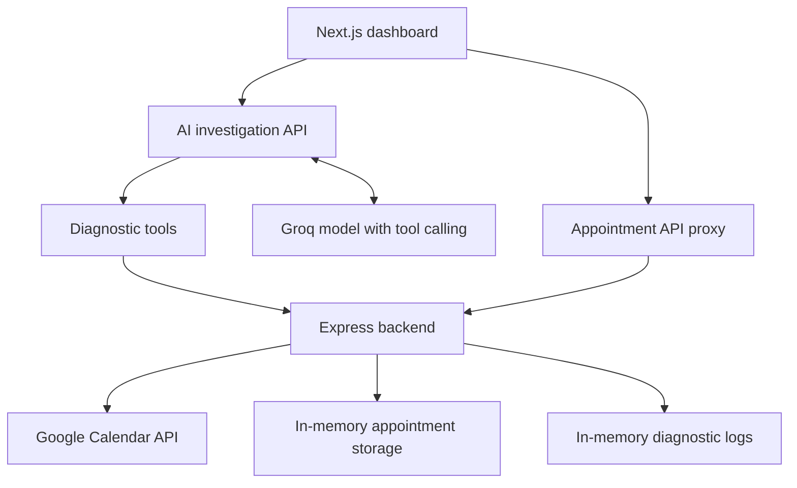

# AppointmentOps

**Book appointments in Google Calendar. Investigate service failures with an AI agent.**

AppointmentOps is a full-stack learning project that combines an appointment service with an AI investigator. The investigator uses diagnostic tools to collect evidence and explain a problem, rather than receiving the hidden failure configuration.

## Features

- Create 30-minute appointments in Google Calendar through OAuth 2.0.
- Check the requested interval for existing busy events before booking.
- View appointments created during the current backend session.
- Submit a natural-language investigation request.
- Inspect an AI report covering status, problem, evidence, and recommended next step.
- Expand tool responses to inspect the evidence behind a report.
- Reproduce three failures through a backend environment variable.
- Run the frontend and backend together with Docker Compose.
- Preserve Google authorization across container restarts using a named volume.

## Architecture



The booking form creates events. The AI investigator is read-only: it diagnoses problems and recommends actions without changing appointments.

## Technology

| Layer | Technology |
| --- | --- |
| Dashboard and API proxy | Next.js, React |
| Interface | CSS, Tailwind CSS, react-markdown |
| Appointment service | Node.js, Express |
| AI provider | Groq SDK with function calling |
| Calendar integration | Google APIs Node.js client, OAuth 2.0 |
| Local orchestration | Docker Compose |

## Agent tools

| Tool | What it checks |
| --- | --- |
| `check_service_health` | Server health plus appointment endpoint status and response time |
| `check_dependencies` | Appointment storage and calendar availability |
| `get_recent_logs` | Recent errors and request durations |

The model selects tools; application code executes them and returns their results. The agent does not receive source files, credentials, or the value of `SCENARIO`. It should distinguish current observations from historical errors and avoid claiming an internal cause unsupported by evidence.

## Project structure

```text
appointment-agent/
├── backend/
│   ├── src/
│   │   ├── server.js
│   │   ├── logger.js
│   │   └── googleCalender.js
│   ├── Dockerfile
│   └── package.json
├── frontend/
│   ├── src/
│   │   ├── app/
│   │   │   ├── api/
│   │   │   ├── page.js
│   │   │   └── globals.css
│   │   ├── components/Appointments.jsx
│   │   └── lib/
│   │       ├── agent.js
│   │       └── tools.js
│   ├── Dockerfile
│   └── package.json
└── compose.yml
```

## Run locally with Docker

### Prerequisites

- Docker Desktop with Docker Compose.
- A Groq API key and access to a tool-capable model.
- A Google account and Google Cloud project with the Calendar API enabled.
- A Google OAuth client of type **Web application**.

### 1. Clone

```bash
git clone https://github.com/tomerkrivzki19/appointment-agent.git
cd appointment-agent
```

### 2. Configure the backend

Create `backend/.env` using your own credentials:

```dotenv
PORT=4000
SCENARIO=healthy
SESSION_SECRET=replace_with_a_random_secret
GOOGLE_CLIENT_ID=your_google_client_id
GOOGLE_CLIENT_SECRET=your_google_client_secret
GOOGLE_REDIRECT_URI=http://localhost:4000/auth/google/callback
GOOGLE_CALENDAR_ID=primary
```

Generate a session secret with Node.js:

```bash
node -e "console.log(require('node:crypto').randomBytes(32).toString('hex'))"
```

### 3. Configure the frontend

Create `frontend/.env`, matching the filename referenced by `compose.yml`:

```dotenv
GROQ_API_KEY=your_groq_api_key
GROQ_MODEL=openai/gpt-oss-120b
APPOINTMENT_SERVICE_URL=http://localhost:4000
```

Compose overrides the service URL with `http://backend:4000` inside the frontend container. Use a model available to your Groq account that supports tool calling.

### 4. Configure Google authorization

In your Google Cloud project:

1. Enable **Google Calendar API**.
2. Configure Google Auth Platform branding and audience.
3. For an external application in Testing, add your Google account as a test user.
4. Create a **Web application** OAuth client.
5. Register this exact authorized redirect URI:

```text
http://localhost:4000/auth/google/callback
```

The application requests the `calendar.events` scope. With `GOOGLE_CALENDAR_ID=primary`, it uses the authorized account's primary calendar.

### 5. Start

```bash
docker compose up --build -d
docker compose ps
```

- Dashboard: http://localhost:3000
- Authorize Google Calendar: http://localhost:4000/auth/google
- Authorization status: http://localhost:4000/auth/google/status
- Dependency checks: http://localhost:4000/dependencies

Authorize Google Calendar, then book a future time that is free for the full 30-minute interval.

The OAuth callback uses `localhost` because your browser follows it. Container-to-container traffic uses the Compose service name `backend`.

## Failure demonstrations

Edit `SCENARIO` in `backend/.env`, then recreate the backend:

```bash
docker compose up -d --force-recreate backend
```

| Scenario | Expected service behavior | Evidence to inspect |
| --- | --- | --- |
| `healthy` | Normal operation, assuming valid Google authorization | Successful requests and available dependencies |
| `storage_down` | Appointment reads and writes fail | Storage unavailable, `ECONNREFUSED`, HTTP 503 |
| `calendar_down` | Booking fails with a simulated provider timeout | Calendar unavailable, `ETIMEDOUT`, timeout logs |
| `slow_response` | Appointment routes wait about five seconds | Measured request duration and slow-request logs |

Use the same instruction for each investigation:

> Investigate the appointment service. Check health, response time, dependencies, and logs.

For each scenario, show the tool responses and explain how they support the report. A process-health response alone does not prove that bookings work. A calendar conflict (HTTP 409) is an expected booking rejection, not a provider outage.

Restore `SCENARIO=healthy` after the demo. For a healthy-state demonstration, ensure Google authorization is valid.

## Demo evidence and screenshots

The project supports a real Google Calendar integration. Screenshots should show these three views together:

1. The dashboard with a successful appointment booking.
2. The matching event in Google Calendar, including its title, date, and time.
3. An investigation report with tool evidence for a simulated failure.

Actual screenshots have not yet been included in this README. Save them under `docs/images/` and link them here after capture. Crop out unrelated personal events, account information, and credentials.

## Useful commands

```bash
# View logs
docker compose logs --tail=80 backend frontend

# Rebuild after code changes
docker compose up --build -d

# Restart the backend to check authorization persistence
docker compose restart backend

# Stop containers while retaining the named volume
docker compose down
```

`docker compose down -v` also removes the volume containing saved Google authorization and requires reconnecting Google afterward.

## Configuration and limitations

- This is a single-user local demonstration, not a production scheduling system.
- Appointment records and logs are held in memory and reset when the backend restarts. Existing Google Calendar events remain saved.
- The appointment list shows this service's current in-memory bookings, not all events in Google Calendar.
- Simulated storage failure does not represent an installed database.
- Checking availability and inserting an event are separate operations; concurrent bookings can race.
- The saved refresh token is stored in a private `.env.google` file in the backend data volume. Do not commit it.
- Google OAuth testing-mode authorization may require renewal after seven days.
- Free model access has rate limits, and AI diagnoses must be checked against tool evidence.
- Tool activity is displayed after the investigation completes; it is not streamed live.

## Credential handling

Environment files, local token data, installed dependencies, and build output must remain excluded from Git and Docker build contexts. Never place secrets in `NEXT_PUBLIC_` variables or include them in screenshots. Each person running the project should configure their own Google and Groq credentials.

## Author

[Tomer Krivizki](https://github.com/tomerkrivzki19)
